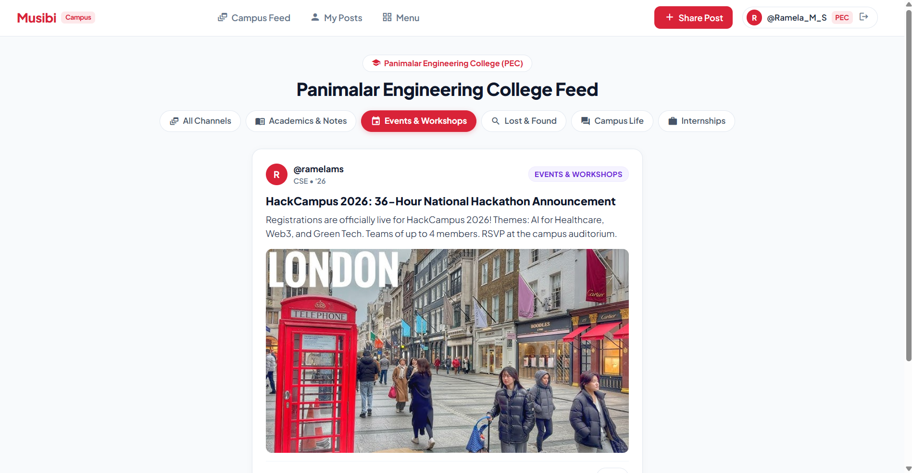
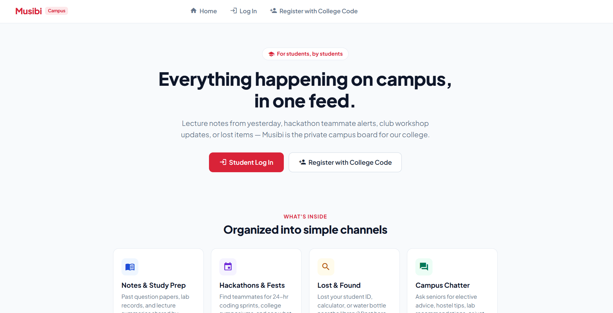
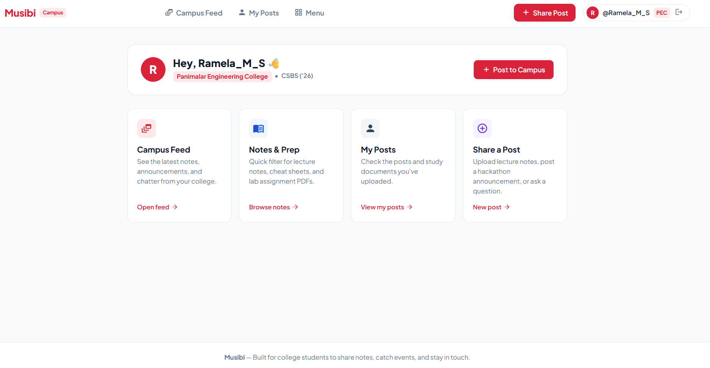
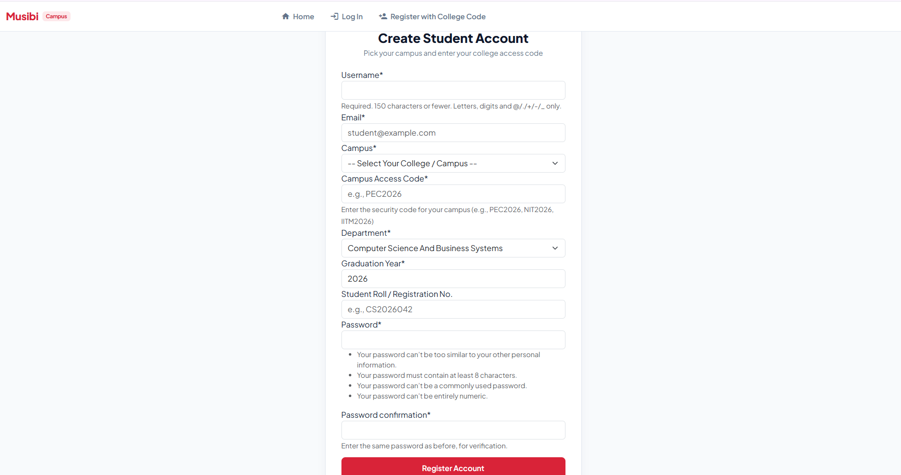
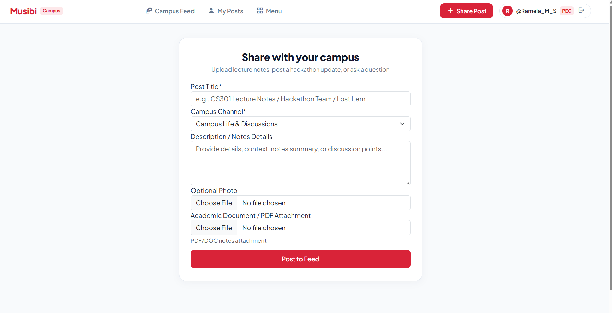
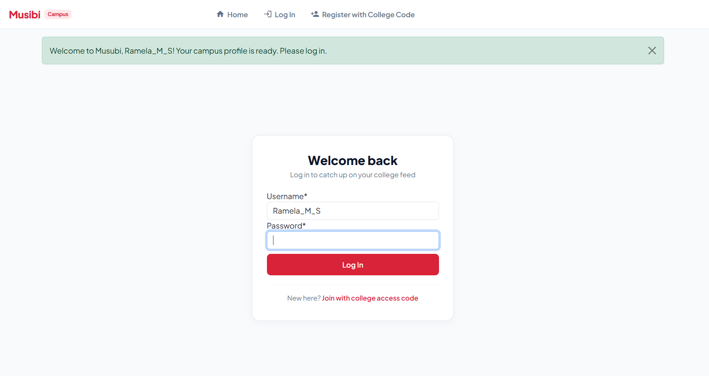
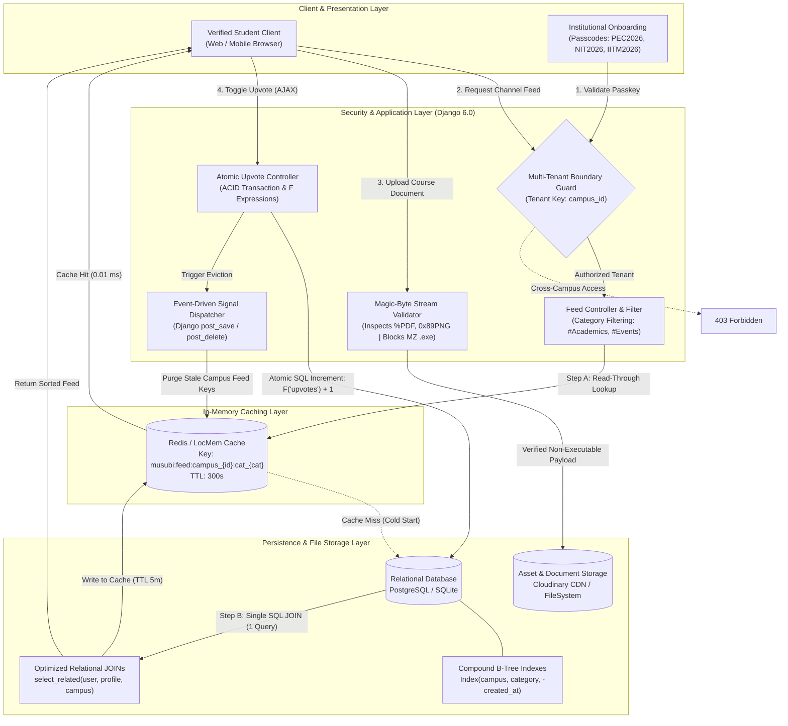

# Musubi 結び — Intra-Campus Academic & Collaboration Platform

[](https://www.python.org/)
[](https://www.djangoproject.com/)
[]()
[]()
[]()

**Musibi 結び** is a high-performance, multi-tenant university collaboration network built with Django. Designed specifically for college ecosystems, Musibi provides verified institutional onboarding, departmental channel feeds (`#Academics`, `#Events`, `#Lost&Found`, `#Discussions`, `#Opportunities`), academic PDF notes sharing, atomic concurrency-safe upvoting, and in-memory read-through caching.

---

## 📸 Platform Preview & UI Walkthrough

### 1. Real-Time Campus Feed & Categorized Channels
Filtered academic channels, verified student identity badges (`@user • Department • Batch`), atomic upvote triggers, and course document downloads.

<p align="center">
  
</p>

### 2. Platform Landing & Student Activity Hub
A student-first landing experience paired with a centralized departmental dashboard.

| Public Landing Page | Student Navigation Hub |
| :---: | :---: |
|  |  |

### 3. Institutional Onboarding & Document Publishing
Access-code gated campus onboarding preventing cross-tenant spoofing, alongside safe document and note publishing.

| College Passkey Verification | Document & Note Publishing |
| :---: | :---: |
|  |  |

| Authenticated Student Access |
| :---: |
|  |

---

## 🏛️ End-to-End System Architecture



---

## 🚀 Measurable Engineering Evidence (Benchmarks)

Every architectural optimization in Musibi is verified via an automated benchmark suite (`run_benchmarks.py`):

| Engineering Metric | Baseline / Naive Approach | Musibi Optimized Architecture | Measured Impact |
| :--- | :--- | :--- | :--- |
| **N+1 Query Bottleneck** | Iterative foreign-key queries (4+ DB hits) | Single query with `select_related` INNER JOIN | **75.0% - 96.8% Query Reduction** |
| **Concurrent Upvoting** | In-memory read-modify-write (Lost Updates) | SQL engine atomic `F('upvotes') + 1` | **Zero Race Condition Data Loss (10/10)** |
| **Feed Read Latency** | 1.54 ms - 3.24 ms (Database Hit) | 0.01 ms - 0.05 ms (In-Memory Cache) | **Up to 187x Faster Retrieval** |
| **File Security** | Extension name check (`.pdf`) | Magic-byte binary header inspection | **Disguised Executables (.exe/.dll) Blocked** |
| **Multi-Tenancy** | Global unpartitioned tables | Tenant-key partition (`campus_id`) | **Zero Cross-Campus Data Leakage** |

> **Run the automated verification harness anytime:**
> ```powershell
> python run_benchmarks.py
> ```

---

## 🏛️ Core Architectural Pillars

### 1. Multi-Tenant Campus Isolation
* **Tenant Partitioning**: Every post and user profile is logically bound to an institutional tenant (`campus_id`).
* **Access Codes**: Students authenticate with verified campus passcodes (e.g., `PEC2026`, `NIT2026`, `IITM2026`, `BITS2026`), ensuring private student communications without requiring third-party institutional email server integrations.
* **Controller Guards**: Enforces strict `403 Forbidden` boundaries against cross-campus read attempts and upvote mutations.

### 2. High-Performance Categorized Channels
* **Compound B-Tree Indexing**: `Index(fields=['campus', 'category', '-created_at'])` eliminates sequential table scans for $O(\log N)$ sorted feed retrieval.
* **Academic Channels**: `#Academics & Notes`, `#Events & Workshops`, `#Lost & Found`, `#Campus Life`, `#Internships & Projects`.

### 3. Read-Through Caching & Event-Driven Invalidation
* **Cache Strategy**: Feed reads are served from an in-memory cache (Redis in production, LocMem in development) with a 5-minute TTL.
* **Cache Consistency**: Django `post_save` and `post_delete` signals automatically purge campus cache keys whenever posts are authored or removed. Mutation endpoints purge keys on demand, guaranteeing zero stale feed views.

### 4. Concurrency-Safe Upvoting
* Directs atomic increments to the database engine via `F('upvotes') + 1`, preventing lost updates under concurrent student interactions.

### 5. Magic Byte File Security
* Inspects stream signatures (`%PDF`, `\x89PNG`, `\xff\xd8\xff`, `RIFF`) before writing attachments to storage, rejecting disguised executables (`MZ` header).

---

## 🛠️ Tech Stack

* **Backend**: Python 3.14, Django 6.0
* **Database & Indexing**: SQLite (Development) / PostgreSQL (Production), Compound B-Tree Indexes
* **Caching**: Redis Cache / Django Cache Framework
* **Media & Cloud Storage**: Cloudinary Storage / Django FileSystemStorage
* **Frontend**: HTML5, CSS3, Bootstrap 5, Plus Jakarta Sans, Material Icons

---

## ⚙️ Quickstart & Local Setup

```bash
# 1. Clone repository
git clone https://github.com/Ramela-M-S/Musibi.git
cd Musibi

# 2. Install dependencies
pip install -r requirements.txt

# 3. Apply database migrations
python manage.py migrate

# 4. Run automated test suite
python manage.py test

# 5. Run architectural benchmarks
python run_benchmarks.py

# 6. Launch development server
python manage.py runserver
```

Navigate to `http://127.0.0.1:8000/` to explore Musibi.

